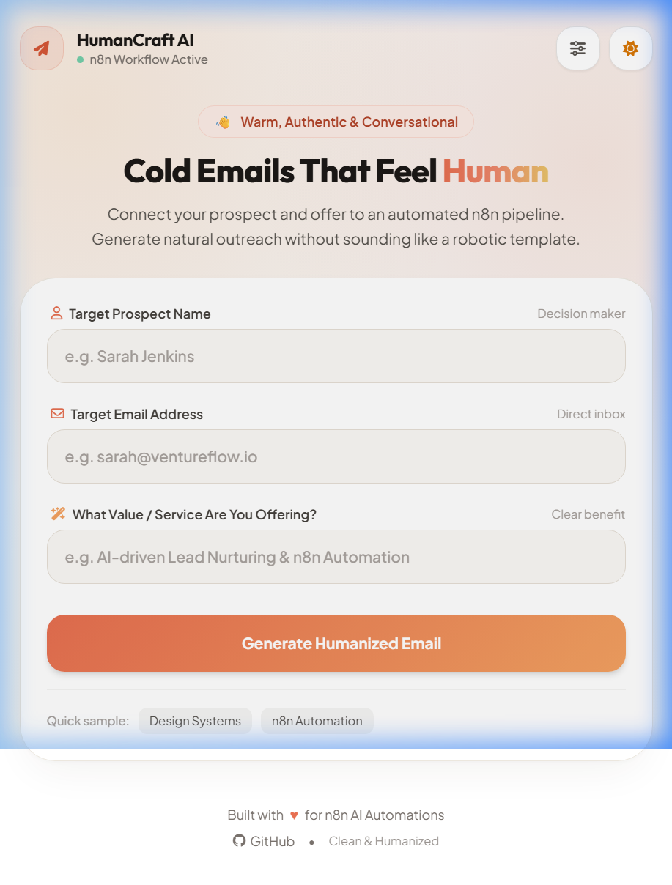
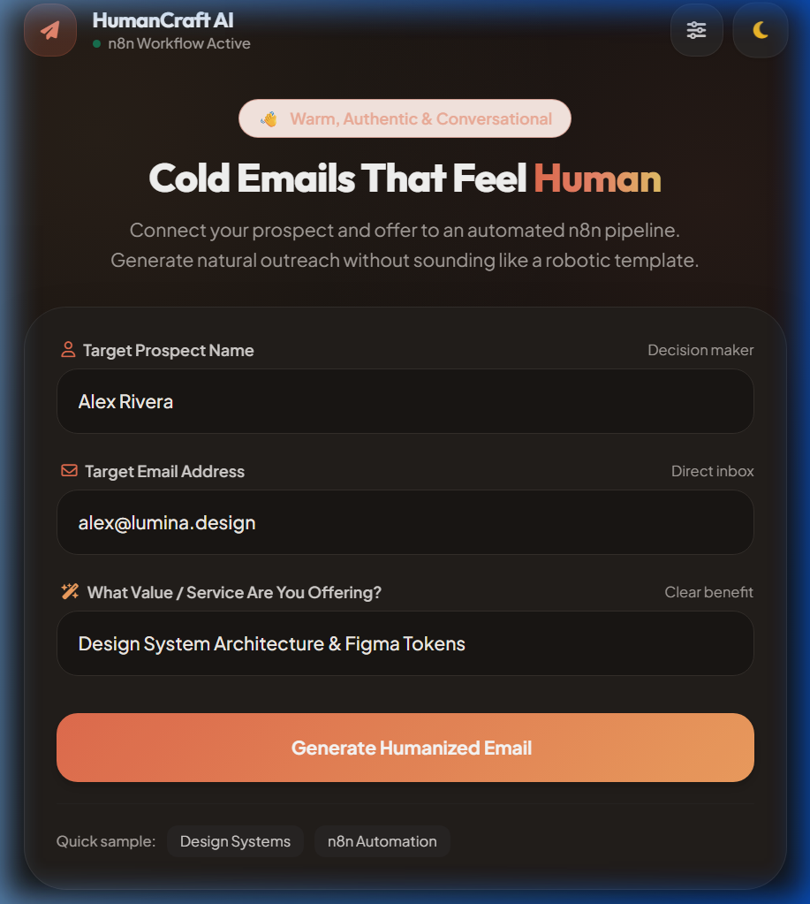

# ✉️ Simple n8n AI Cold Mailing

> A clean, human-first cold email generation suite powered by **n8n workflow automation** and modern LLMs. Designed with a warm, humanized aesthetic inspired by the **Humaaans** design style.

---

## 📸 Visual Preview

<div align="center">
  
  
</div>

---

## 🌟 Overview

Cold outreach only works when it sounds like a genuine, thoughtful human talking to another human. Most AI-generated cold emails fail because they sound like robotic corporate fluff.

**Simple n8n AI Cold Mailing** combines a clean, human-centric web application with the flexibility of **n8n automation** to generate concise, value-focused, and natural-sounding cold emails in seconds.

---

## 🧠 About n8n & AI Automation

### What is n8n?
**[n8n](https://n8n.io/)** is a powerful, fair-code workflow automation platform. Unlike closed proprietary automation tools, n8n can be self-hosted, customized with custom JavaScript/Python code nodes, and connected directly to any API, database, or LLM.

Key advantages of n8n:
- **Visual Node Canvas**: Build complex backends without writing repetitive boilerplate API code.
- **Webhook First**: Turn any automated sequence into an instant API endpoint for frontend apps.
- **Privacy & Control**: Host your workflows on your own infrastructure so sensitive sales data stays private.
- **Native AI Support**: Chain together LangChain agents, AI models (OpenAI, Gemini, Anthropic), vector stores, and custom prompts seamlessly.

### Why AI Automation for Cold Emailing?
Traditional cold outreach has two extremes:
1. **Manual 1-to-1 writing**: High quality, but slow and unscalable.
2. **Mass mail-merge spam**: Fast, but low conversion, impersonal, and damages domain reputation.

**AI Automation bridges this gap**:
- Dynamically analyzes the prospect's name, role, and specific pain points.
- Tailors your unique value proposition to their exact context.
- Adheres to proven outbound principles (concise hook, no robotic filler words, human tone, friction-free CTA).

---

## 🎨 Clean & Humanized Design (Humaaans Aesthetic)

The user interface is intentionally styled away from harsh, dark-neon cyberpunk and instead built on **Pablo Stanley's Humaaans design philosophy**:
- **Warm Canvas Palette**: Soft oat/cream canvas (`#FAF8F5`), rich terracotta coral (`#E76F51`), sunny amber (`#F4A261`), and eucalyptus sage (`#2A9D8F`).
- **Warm Dark Mode**: Deep obsidian espresso (`#181513`) with warm peach accents instead of cold blue/purple.
- **Human Typography**: Uses *Plus Jakarta Sans* and *Outfit* for approachable, readable typography.
- **Thoughtful Micro-Interactions**: One-click subject & email copy, direct `mailto:` launcher, and live webhook configuration drawer.

---

## 🔄 System Architecture

```mermaid
flowchart LR
    A[👤 Prospect Info\nClient Name + Email + Service] --> B[🖥️ Frontend Web App\nindex.html]
    B -->|HTTP POST JSON| C[⚡ n8n Webhook Node\n/webhook/...]
    C --> D[🤖 AI LLM Node\nOpenAI / Gemini / Anthropic]
    D -->|Raw AI Output| E[⚙️ Code Node\ncodeNode.js]
    E -->|JSON { subject, body }| F[📬 Respond to Webhook]
    F -->|Instant Response| B
    B --> G[📋 1-Click Copy & Mail Client]
```

---

## 📁 Repository Structure

```text
simple-n8n-ai-cold-mailing-/
├── assets/
│   ├── preview-light.png # Light mode preview
│   └── preview-dark.png  # Dark mode preview
├── index.html            # Clean, humanized frontend UI (Tailwind CSS + Vanilla JS)
├── codeNode.js           # n8n Code Node script (parses LLM output into subject & body)
├── prompt.txt            # High-conversion cold email prompt template
└── README.md             # Comprehensive project documentation
```

### File Highlights

1. **`index.html`**
   - Humanized responsive interface with light/dark theme toggle.
   - Live settings drawer to update your n8n webhook URL on the fly.
   - Built-in mock preview mode (allows testing even if n8n is offline).
   - Independent "Copy Subject" and "Copy Email" actions.

2. **`codeNode.js`**
   - Sits right after your AI node in n8n.
   - Cleans up markdown, isolates the `Subject:` header, and separates the email body for clean frontend rendering.

3. **`prompt.txt`**
   - Enforces strict outbound rules: eliminates bracketed placeholders (like `[Your Name]`), bans corporate fluff (`"Hope this email finds you well"`), and delivers a conversational draft.

---

## 🚀 Quick Start Guide

### 1. Prerequisites
- **n8n** installed and running (Docker, Cloud, or `npx n8n`).
- An API key for your preferred AI model (OpenAI, Google Gemini, Anthropic, or Ollama for local models).

### 2. Configure the n8n Workflow
1. Create a new workflow in n8n.
2. Add a **Webhook Node**:
   - HTTP Method: `POST`
   - Path: `webhook/2fdb77ec-b271-4d99-b8c1-58519abb889f` (or your preferred UUID)
   - Response Mode: *When Last Node Finishes* or *Using 'Respond to Webhook' Node*.
3. Add an **AI / LLM Node** (e.g., OpenAI Chat Model or Gemini):
   - Paste the instructions from [`prompt.txt`](./prompt.txt) into your prompt or system message.
   - Map parameters:
     - `{{ $json.body.clientName }}`
     - `{{ $json.body.clientEmail }}`
     - `{{ $json.body.service }}`
4. Add a **Code Node**:
   - Language: `JavaScript`
   - Paste the code from [`codeNode.js`](./codeNode.js).
5. Add a **Respond to Webhook Node**:
   - Respond With: `JSON`
   - Pass the output of the Code node (`{{ $json }}`).
6. **Activate** the workflow!

### 3. Run the Frontend
You can run `index.html` using any local server or simply open it in your browser:

```bash
# Option A: Using Python 3
python -m http.server 3000

# Option B: Using Node npx serve
npx serve .

# Option C: VS Code Live Server extension
# Right click index.html -> "Open with Live Server"
```

Open `http://localhost:3000` (or `index.html`), configure your webhook URL in the settings drawer (if different from default), fill in your prospect's details, and click **Generate Humanized Email**!

---

## 💡 Best Practices for Outbound Sales with AI

- **Keep it under 100 words**: Busy prospects read emails on mobile in under 10 seconds.
- **Focus on the prospect, not yourself**: Highlight the prospect's potential outcome, not your list of features.
- **Low-friction CTA**: Never ask for a 45-minute demo on the first touch. Ask a simple interest-based question like: *"Worth a quick 5-min look next week?"*
- **Personalize your sender info**: Update `prompt.txt` with your own name, company, and value proposition.

---

## 🛠️ Tech Stack

- **Frontend**: HTML5, Vanilla JavaScript, [Tailwind CSS CDN](https://tailwindcss.com/)
- **Icons**: Font Awesome 6
- **Typography**: Google Fonts (*Outfit* + *Plus Jakarta Sans*)
- **Automation Engine**: [n8n](https://n8n.io/)
- **AI Models Supported**: Google Gemini, OpenAI GPT-4o / GPT-4o-mini, Anthropic Claude, Groq, Ollama

---

## 👤 Author

Developed by **Mohammed Mufeed**  
GitHub: [@mohhdmufeed](https://github.com/mohhdmufeed)  
Repository: [simple-n8n-ai-cold-mailing-](https://github.com/mohhdmufeed/simple-n8n-ai-cold-mailing-)

---

## 📄 License

This project is open-source and available under the [MIT License](LICENSE).
