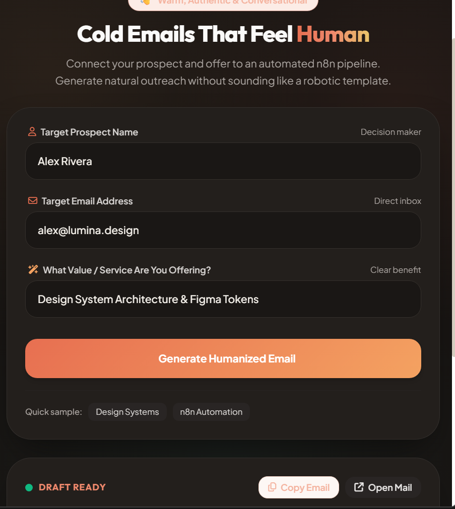
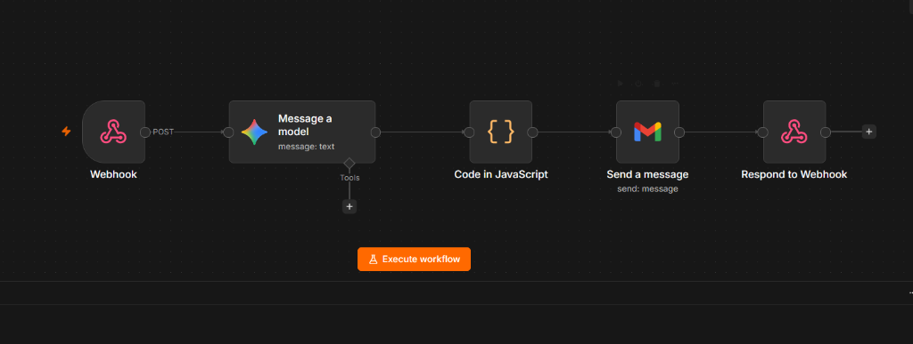
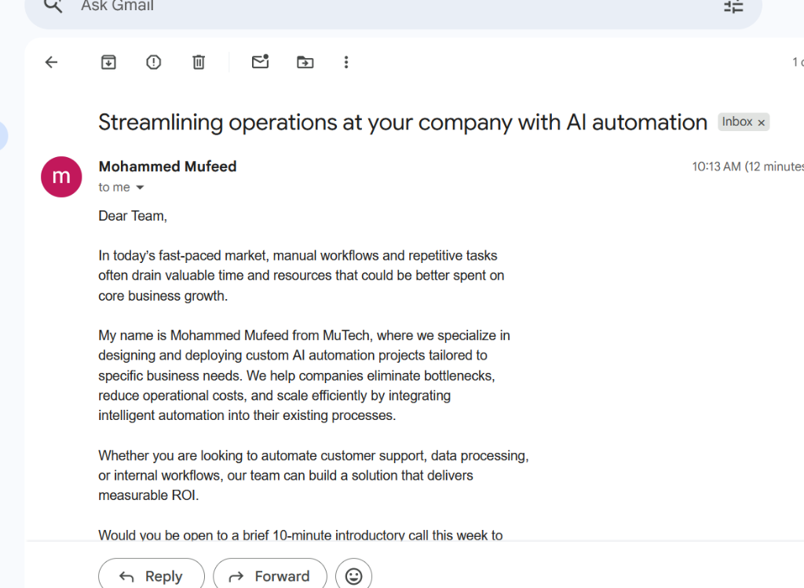
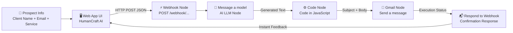

# ✉️ Simple n8n AI Cold Mailing

> An end-to-end automated cold email pipeline powered by **n8n workflow automation**, modern LLMs, and direct **Gmail dispatch**. Features a clean, human-first web application designed with the warm **Humaaans** aesthetic.

---

## 📸 Visual Showcase

### 1. Web Application Interface (HumanCraft AI)
<div align="center">
  
</div>

<br>

### 2. Live n8n Automation Pipeline
<div align="center">
  
</div>

<br>

### 3. Automated Gmail Delivery (Direct to Prospect's Inbox)
<div align="center">
  
</div>

---

## 🌟 Overview

Cold outreach only works when it sounds like a genuine, thoughtful human talking to another human. Most AI-generated cold emails fail because they sound like robotic corporate fluff.

**Simple n8n AI Cold Mailing** bridges human touch and automation:
1. You provide the prospect's name, email, and value offering via a friendly web UI.
2. An **n8n automation workflow** receives the payload via webhook.
3. An **AI model** drafts a conversational, high-converting pitch (no placeholders or corporate cliches).
4. A **JavaScript Code node** parses and extracts the subject and email body.
5. **Gmail integration** automatically dispatches the email directly from your account to the prospect's inbox.
6. The web UI receives a confirmation and displays the live draft with one-click copy options.

---

## 🧠 About n8n & AI Automation

### What is n8n?
**[n8n](https://n8n.io/)** is a powerful, fair-code workflow automation platform. Unlike closed proprietary automation tools, n8n can be self-hosted, customized with JavaScript code nodes, and directly connected to any API, database, or LLM.

Key advantages of n8n:
- **Visual Node Canvas**: Build full-stack backend pipelines without writing boilerplate server code.
- **Webhook First**: Turn any automated sequence into an instant API endpoint for frontend apps.
- **Privacy & Security**: Host workflows on your own machine/server so sensitive client leads stay private.
- **Multi-Service Chaining**: Easily chain Webhooks $\rightarrow$ AI Models $\rightarrow$ Code Logic $\rightarrow$ Gmail / CRM $\rightarrow$ Response.

### Why AI Automation for Cold Emailing?
Traditional outbound faces two extremes:
1. **Manual 1-to-1 writing**: High conversion, but exhausting and unscalable.
2. **Mass mail-merge spam**: Fast, but generic, impersonal, and burns domain reputation.

**Intelligent AI Automation solves both**:
- Dynamically customizes value propositions to the prospect's specific market.
- Follows proven outbound frameworks (3-sentence rule, low-friction call-to-action).
- Eliminates manual drafting while maintaining an authentic human voice.

---

## 🔄 End-to-End Workflow Architecture



---

## 🎨 Clean & Humanized Design (Humaaans Aesthetic)

The web UI is styled away from harsh, dark-neon cyberpunk and instead built on **Pablo Stanley's Humaaans design philosophy**:
- **Warm Canvas Palette**: Soft oat/cream canvas (`#FAF8F5`), rich terracotta coral (`#E76F51`), sunny amber (`#F4A261`), and eucalyptus sage (`#2A9D8F`).
- **Warm Dark Mode**: Deep obsidian espresso (`#181513`) with warm peach accents.
- **Human Typography**: Uses *Plus Jakarta Sans* and *Outfit* for approachable, readable typography.
- **Webhook Drawer**: Configure your local or cloud n8n webhook URL on the fly directly in the UI.
- **Interactive Action Buttons**: Independent "Copy Subject", "Copy Email", and "Open Mail" (`mailto:`) actions.

---

## 📁 Repository Structure

```text
simple-n8n-ai-cold-mailing-/
├── assets/
│   ├── ui-demo.png       # Live UI screenshot
│   ├── n8n-workflow.png  # n8n visual canvas screenshot
│   ├── gmail-output.png  # Live email delivery proof in Gmail
│   ├── preview-light.png # Light mode card view
│   └── preview-dark.png  # Dark mode card view
├── index.html            # Clean, humanized frontend UI (Tailwind CSS + Vanilla JS)
├── codeNode.js           # n8n Code Node script (parses LLM output into subject & body)
├── prompt.txt            # High-conversion cold email prompt template (Mohammed Mufeed / MuTech)
└── README.md             # Comprehensive project documentation
```

---

## 🚀 Quick Start Guide

### 1. Prerequisites
- **n8n** installed and running (`npx n8n`, Docker, or n8n Cloud).
- An AI model credential (OpenAI, Google Gemini, Anthropic, or Ollama).
- A Gmail account connected via OAuth2 in n8n.

### 2. Configure the n8n Workflow
1. **Webhook Node**:
   - HTTP Method: `POST`
   - Path: `webhook/2fdb77ec-b271-4d99-b8c1-58519abb889f` (or your custom UUID).
2. **Message a model (AI) Node**:
   - Model: OpenAI GPT-4o / GPT-4o-mini or Google Gemini.
   - Prompt: Paste content from [`prompt.txt`](./prompt.txt).
   - Variables: `{{ $json.body.clientName }}`, `{{ $json.body.clientEmail }}`, `{{ $json.body.service }}`.
3. **Code in JavaScript Node**:
   - Paste the parsing script from [`codeNode.js`](./codeNode.js).
4. **Gmail: Send a message Node**:
   - Resource: `Message`, Operation: `Send`.
   - To: `{{ $('Webhook').item.json.body.clientEmail }}`.
   - Subject: `{{ $json.subject }}`.
   - Email Type: `Plain Text`.
   - Message: `{{ $json.body }}`.
5. **Respond to Webhook Node**:
   - Respond With: `Text` or `JSON` (`Email sent successfully!`).
6. **Activate** the workflow!

### 3. Run the Frontend
Run `index.html` using any local server or simply open it in your browser:

```bash
# Option A: Using Python 3
python -m http.server 3000

# Option B: Using Node npx serve
npx serve .

# Option C: Direct browser execution
# Double click index.html
```

---

## 💡 Best Practices for Outbound Sales with AI

- **Keep it under 100 words**: Busy prospects scan emails on mobile in under 10 seconds.
- **Focus on the prospect, not yourself**: Highlight the business bottleneck you solve, not an endless list of technical features.
- **Low-friction CTA**: Never ask for a 45-minute demo on cold outreach. Ask: *"Would you be open to a brief 10-minute introductory call this week?"*
- **Personalize your sender info**: Customize [`prompt.txt`](./prompt.txt) with your name and company.

---

## 🛠️ Tech Stack

- **Frontend**: HTML5, Vanilla JavaScript, [Tailwind CSS CDN](https://tailwindcss.com/)
- **Typography & Icons**: Google Fonts (*Outfit* + *Plus Jakarta Sans*), Font Awesome 6
- **Workflow Automation Engine**: [n8n](https://n8n.io/)
- **AI Models Supported**: Google Gemini, OpenAI GPT-4o / GPT-4o-mini, Anthropic Claude, Groq, Ollama
- **Outbound Channel**: Gmail API Integration

---

## 👤 Author

Developed by **Mohammed Mufeed**  
GitHub: [@mohhdmufeed](https://github.com/mohhdmufeed)  
Repository: [simple-n8n-ai-cold-mailing-](https://github.com/mohhdmufeed/simple-n8n-ai-cold-mailing-)

---

## 📄 License

This project is open-source and available under the [MIT License](LICENSE).
